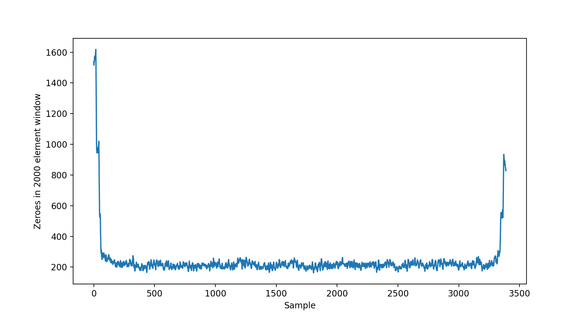
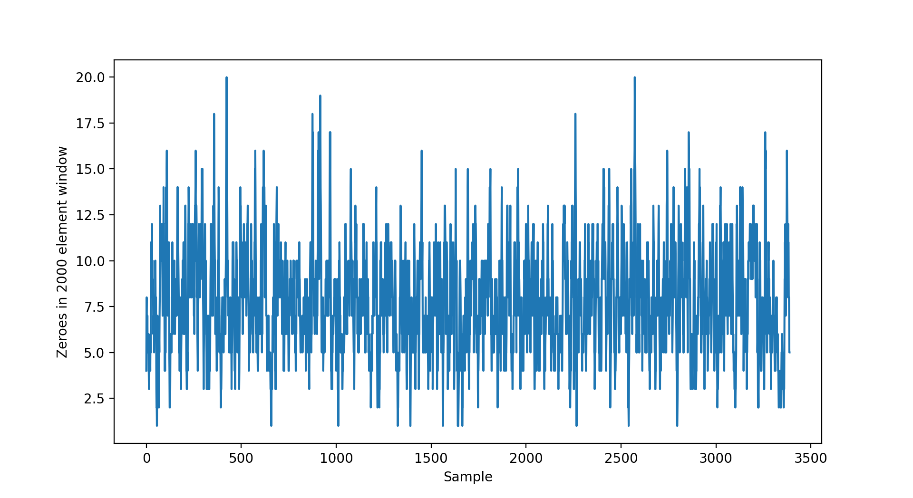

# xorf

[](https://docs.rs/xorf)
[](https://crates.io/crates/xorf)
[](https://github.com/ayazhafiz/xorf/actions/workflows/ci.yml)

- [Documentation](https://docs.rs/xorf)
- [Crates.io Registry](https://crates.io/crates/xorf)

This repository hosts a Rust library implementing
[xor filters](https://arxiv.org/abs/1912.08258) and their derivates:

- Binary Fuse filters (most recommended)
  - [`BinaryFuse8`](./src/bfuse8.rs), [`BinaryFuse16`](./src/bfuse16.rs), [`BinaryFuse32`](./src/bfuse32.rs)
- Xor filters
  - [`Xor8`](./src/xor8.rs), [`Xor16`](./src/xor16.rs), [`Xor32`](./src/xor32.rs)
- Fuse filters (deprecated, use Binary Fuse filters instead)
  - [`Fuse8`](./src/fuse8.rs), [`Fuse16`](./src/fuse16.rs), [`Fuse32`](./src/fuse32.rs)

Xor filters are data structures for fast approximation of set membership using
little memory. Probabilistic filters like
xor filters are useful when it's okay to have false positives sometimes, but
it's important to be space and time efficient. In other words, they trade off
accuracy for efficiency as compared to general-purpose hashsets. Filters like
xor filter are often used in conjunction with larger hash-based data structures,
with the filter doing a "first pass" of the work to avoid using a more expensive
resource unnecessarily. For example, filters like xor filters can be used to
[reduce disk writes](https://en.wikipedia.org/wiki/Bloom_filter#Cache_filtering)
in a cache or
[identify malicious URLs](https://en.wikipedia.org/wiki/Bloom_filter#Examples)
in a browser.

Xor filters are faster and smaller than Bloom and Cuckoo filters. Xor filters
incur a relative time penalty in construction, but are very fast in lookups; the
expectation is that construction of a filter is amortized after many queries.
Daniel Lemire's [go implementation](https://github.com/FastFilter/xorfilter)
provides a useful summary of xor filters' benefits and listing of other xor
filter libraries.

This library is `no_std` and uses [`alloc`](https://doc.rust-lang.org/alloc/).
The final application supplies an allocator; no nightly-only crate feature is
required. The default `uniform-random` feature uses the operating system's
thread-local random number generator, so embedded targets should disable default
features as shown below.

`xorf` also provides a [`HashProxy`](./src/hash_proxy.rs) for using Xor filters
with arbitrary key types.

## Installation

Add a dependency to `xorf` in `Cargo.toml`:

```toml
[dependencies]
xorf = "0.14"
```

Available versions are listed on [crates.io](https://crates.io/crates/xorf) and
in the [repository's releases](https://github.com/ayazhafiz/xorf/releases).

## Usage

Please see the [library documentation](https://docs.rs/xorf) for usage
information.

### Features

The supported user-facing features are:

| Feature | Default | Effect |
|---|---:|---|
| `binary-fuse` | Yes | Exposes the recommended Binary Fuse implementations. |
| `uniform-random` | Yes | Randomizes unused fingerprints to improve their distribution; requires a `std`-capable target. |
| `serde` | No | Implements Serde serialization and deserialization. |
| `bincode` | No | Legacy compatibility alias for `serde`; native bincode traits were removed in 0.14. |

Serialization with [Serde](https://serde.rs/) can be enabled independently:

```toml
[dependencies]
xorf = { version = "0.14", features = ["serde"] }
```

The old `bincode` feature remains as an alias for `serde`, so existing
manifests continue to resolve. Native bincode `Encode` and `Decode` impls were
removed because bincode is unmaintained. Applications that still use bincode
can serialize these types through bincode's Serde support while they migrate.

```toml
[dependencies]
xorf = { version = "0.14", features = ["bincode"] }
```

#### Default features

##### Uniform Random

By default, `xorf` uses the `uniform-random` feature, which uses random values for unused
fingerprint entries rather than initializing them to zero. This provides a slightly lower false-positive
rate, but incurs a higher initialization cost. The cost of lookups is not affected.

The distribution of zero-valued fingerprints for a 1,000,000-element
`BinaryFuse8` filter, both without and with the `uniform-random` feature, is
visualized below. Notice that the scales of the y-axes differ.

| `BinaryFuse8` without `uniform-random` | `BinaryFuse8` with `uniform-random` |
|--|--|
|  |  |

To disable the `uniform-random` feature, specify that default features should be disabled:

```toml
[dependencies]
xorf = { version = "0.14", default-features = false }
```

For a `no_std` target that has `alloc` and needs Binary Fuse filters:

```toml
[dependencies]
xorf = { version = "0.14", default-features = false, features = ["binary-fuse"] }
```

##### Binary Fuse

By default, `xorf` uses the `binary-fuse` feature, which adds support for and
exposes Binary Fuse filter implementations. This feature pulls in a dependency
of `libm`, but has no runtime cost. This feature is highly recommended, as
Binary Fuse filters are the most powerful in the Xor filter family.

## Compatibility

The minimum supported Rust version (MSRV) is 1.85. The CI suite builds the
complete library API on that compiler and separately checks current stable,
beta, nightly, and an embedded `no_std` target.

Modernization releases preserve the existing public Rust API, Cargo feature
names and defaults, and Serde and DMA representations. Version 0.14 removes
native bincode traits while retaining `bincode` as a Serde-enabling migration
alias. CI compares the public API with the latest crates.io release to catch
accidental SemVer breaks. The DMA descriptor is little-endian; 16- and 32-bit
fingerprint buffers remain native-endian and must meet the documented
alignment requirements.

## Development

Development of `xorf` targets the master branch of this repository.

Run the same core checks used by CI with:

```bash
cargo fmt --all -- --check
cargo clippy --workspace --all-targets --all-features -- -D warnings
cargo test -p xorf --all-features
cargo test -p xorf --no-default-features
cargo package -p xorf
```

## Contribution

Contributions are warmly welcomed. No contribution is too small, and all are
appreciated.

## License

[MIT](./LICENSE)
